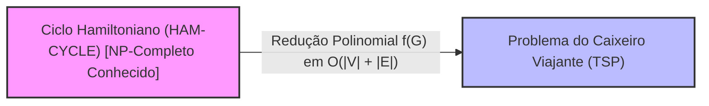
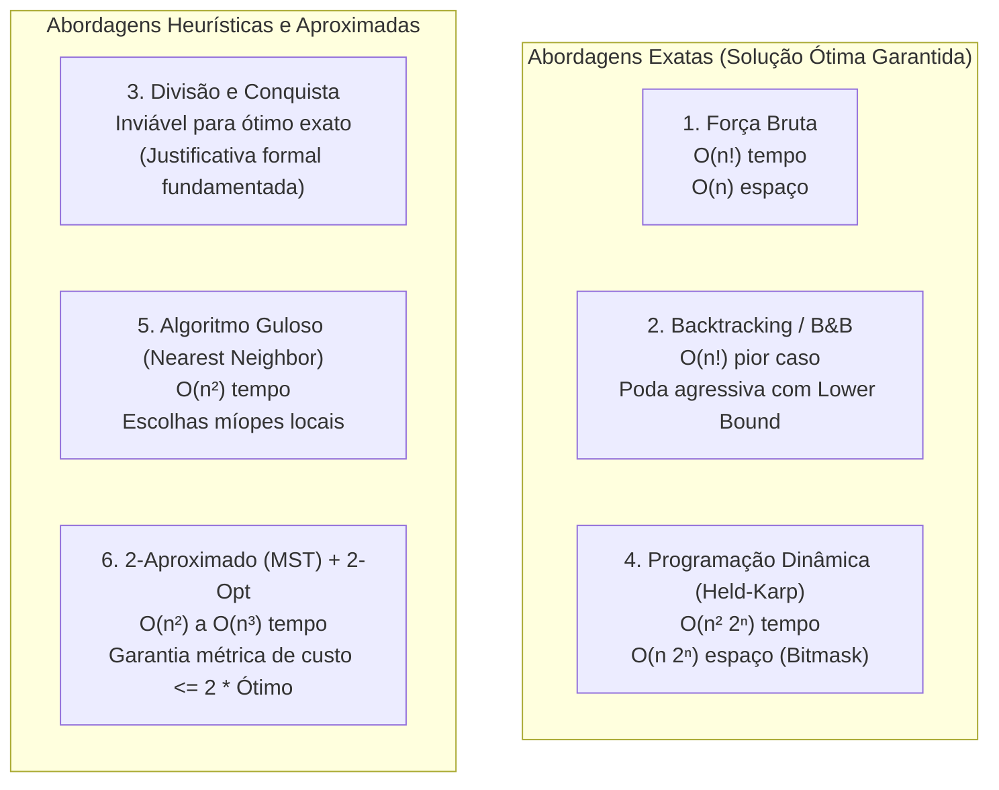

# Dossiê Teórico do Problema do Caixeiro Viajante (TSP)

**Disciplina:** Análise e Projeto de Algoritmos (APA)  
**Tema:** Item 3 — Traveling Salesperson Problem (TSP)  
**Objetivo:** Fornecer todo o arcabouço conceitual, matemático e algorítmico necessário para o desenvolvimento do trabalho final, incluindo a prova formal de NP-completude, justificativas de inviabilidade e propostas de solução.

---

## 1. Contexto Histórico e Aplicações Práticas no Mundo Real

O Problema do Caixeiro Viajante é um dos problemas de otimização combinatória mais célebres da ciência da computação e da pesquisa operacional. Formulado inicialmente no século XIX por matemáticos como William Rowan Hamilton e Thomas Kirkman, o problema ganhou tratamento matemático sistemático na década de 1930 em Viena e Princeton por Karl Menger e Hassler Whitney.

> **Importância para a Apresentação Oral (Maior Peso da Avaliação):**  
> O edital destaca que *"o critério de maior peso na avaliação será a profundidade da apresentação, especialmente no que se refere à análise e à discussão das aplicações práticas do problema estudado"*.

### Aplicações Reais do TSP:
1. **Logística e Cadeia de Suprimentos:** Roteamento de frotas de entrega (ex.: Correios, Amazon, distribuidoras de alimentos). Minimizar quilometragem percorrida traduz-se diretamente em economia de combustível e redução de emissão de carbono.
2. **Fabricação de Circuitos Integrados (PCB Drilling):** Na indústria de microeletrônica, braços robóticos perfuram milhares de furos em placas de circuito impresso. O trajeto percorrido pela broca entre os furos é exatamente uma instância euclidiana do TSP; reduzir o percurso aumenta dramaticamente o rendimento das fábricas por hora.
3. **Sequenciamento Genômico (Bioinformática):** Reconstrução de sequências de DNA a partir de fragmentos sobrepostos (*Shotgun Sequencing*), onde as distâncias representam dissimilaridades ou penalidades entre fragmentos.
4. **Telescópios Espaciais e Satélites:** Otimização do tempo de redirecionamento de espelhos e lentes de telescópios (como o Hubble ou James Webb) para observar centenas de corpos celestes em uma única missão, minimizando o gasto de combustível de propulsão.
5. **Roteamento de Veículos Autônomos e Drones:** Planejamento de trajetória para varredura de terrenos agrícolas, inspeção de linhas de transmissão e entrega rápida de suprimentos médicos.

---

## 2. Formalização Matemática do Problema

### 2.1. Formulação em Teoria dos Grafos
Seja um grafo completo e valorado $G = (V, E)$, onde:
* $V = \{v_1, v_2, \dots, v_n\}$ é o conjunto de $n$ vértices (cidades).
* $E = \{(u, v) : u, v \in V, u \neq v\}$ é o conjunto de arestas direcionadas ou não direcionadas.
* $w: E \to \mathbb{R}^+$ é uma função de custo/distância que associa a cada aresta $(u, v)$ um peso não negativo $w(u, v)$ (frequentemente denotado por $d_{uv}$).

Uma **rota válida** (ou ciclo hamiltoniano) é uma permutação $\pi = (\pi_1, \pi_2, \dots, \pi_n)$ dos vértices de $V$, com retorno à cidade de origem ($\pi_{n+1} = \pi_1$).

O **custo total da rota**, denotado por $C(\pi)$, é dado por:
$$C(\pi) = \sum_{i=1}^{n} w(\pi_i, \pi_{i+1}) \quad (\text{com } \pi_{n+1} = \pi_1)$$

### 2.2. TSP Simétrico vs. Assimétrico
* **TSP Simétrico:** Para todo par de cidades $u, v \in V$, tem-se $w(u, v) = w(v, u)$. O grafo é não direcionado e o número de rotas possíveis é $\frac{(n-1)!}{2}$.
* **TSP Assimétrico (ATSP):** Pode existir $w(u, v) \neq w(v, u)$ (ex.: ruas de mão única, tráfego ou gradiente de altitude). O número de rotas possíveis é $(n-1)!$.

### 2.3. TSP Métrico (Desigualdade Triangular)
Uma instância satisfaz a **desigualdade triangular** se, para quaisquer cidades $u, v, z \in V$:
$$w(u, z) \le w(u, v) + w(v, z)$$
Isso significa que pegar um atalho direto nunca é mais custoso do que passar por um vértice intermediário. O TSP Métrico é fundamental porque permite garantias teóricas de aproximação (algoritmos 2-aproximados e algoritmo de Christofides).

### 2.4. Problema de Otimização vs. Problema de Decisão
* **TSP Otimização:** Encontrar a permutação $\pi^*$ que minimize $C(\pi)$, isto é:
  $$\pi^* = \arg\min_{\pi \in \Pi} C(\pi)$$
* **TSP Decisão:** Dado o grafo $G = (V, E)$, a matriz de pesos $w$ e um limite inteiro/real $B \in \mathbb{R}^+$:
  $$\text{Existe um ciclo hamiltoniano em } G \text{ com custo } C(\pi) \le B\text{?}$$

---

## 3. Demonstração Formal de que o TSP Pertence à Classe NP e é NP-Completo

Para demonstrar formalmente que o TSP na versão de decisão ($TSP_D$) é **NP-Completo** (conforme exigido na Seção 47 do edital com base em Cormen et al. [1]), devemos provar duas etapas:
1. $TSP_D \in \text{NP}$ (Verificação Polinomial).
2. $TSP_D \text{ é NP-Difícil}$ (Redução Polinomial a partir de um problema já conhecido como NP-Completo).

### Prova 1: $TSP_D \in \text{NP}$
Para provar que $TSP_D \in \text{NP}$, basta apresentar um algoritmo verificador de tempo polinomial para um certificado fornecido:
1. **Certificado:** Uma sequência ordenada de vértices $\pi = (\pi_1, \pi_2, \dots, \pi_n)$.
2. **Algoritmo Verificador:**
   * Verifica se $|\pi| = n$ e se cada elemento de $V$ aparece exatamente uma vez em $\pi$. Isso pode ser feito em $O(n)$ usando uma tabela hash ou vetor de booleanos.
   * Calcula a soma das arestas:
     $$S = w(\pi_n, \pi_1) + \sum_{i=1}^{n-1} w(\pi_i, \pi_{i+1})$$
     Essa soma envolve $n$ adições e consultas à matriz, executando em tempo $O(n)$.
   * Compara se $S \le B$.
3. **Conclusão:** Como a verificação opera em tempo $O(n)$, estritamente polinomial no tamanho da entrada, **$TSP_D \in \text{NP}$**.

---

### Prova 2: $TSP_D$ é NP-Difícil (Redução a partir do Ciclo Hamiltoniano)
Utilizaremos o problema do **Ciclo Hamiltoniano (HAM-CYCLE)**, classicamente provado como NP-completo por Karp (1972) e abordado em Cormen et al. [1, Cap. 34]:
* *Instância de HAM-CYCLE:* Um grafo não direcionado $G = (V, E)$. Pergunta: $G$ contém um ciclo que visita cada vértice em $V$ exatamente uma vez?

#### Construção da Redução Polinomial:
Dada uma instância arbitrária $G = (V, E)$ de HAM-CYCLE, construímos uma instância $\langle G', w, B \rangle$ de $TSP_D$ da seguinte forma:
1. Definimos o grafo completo $G' = (V, E')$, onde $E' = \{(u, v) : u, v \in V, u \neq v\}$. O conjunto de vértices é idêntico.
2. Definimos a função de pesos $w$ para cada aresta $(u, v) \in E'$:
   $$w(u, v) = \begin{cases} 1, & \text{se } (u, v) \in E \text{ (aresta original existia em } G) \\ 2, & \text{se } (u, v) \notin E \text{ (aresta ausente em } G) \end{cases}$$
3. Definimos o limite de custo $B = |V| = n$.

Essa transformação constrói o grafo completo $G'$ e a matriz de pesos em tempo $O(|V|^2)$, que é estritamente polinomial.

#### Equivalência Lógica Bidirecional:
Devemos provar que $G$ possui um ciclo hamiltoniano se e somente se $G'$ possui um tour TSP de custo $\le n$:

* $(\Rightarrow)$ **Se $G$ tem um ciclo hamiltoniano:**  
  Seja $C$ um ciclo hamiltoniano em $G$. Esse ciclo visita todos os $n$ vértices usando apenas arestas pertencentes a $E$. Como cada aresta de $E$ tem peso $1$ em $G'$, o custo total de $C$ em $G'$ é:
  $$w(C) = \sum_{e \in C} w(e) = \sum_{e \in C} 1 = n \le B$$
  Portanto, a resposta para a instância de $TSP_D$ é SIM.

* $(\Leftarrow)$ **Se $G'$ tem um tour TSP de custo $\le n$:**  
  Seja $\pi$ um tour de custo $\le n$ em $G'$. O tour contém exatamente $n$ arestas.  
  Como todos os pesos de arestas em $G'$ são inteiros positivos ($1$ ou $2$), e a soma das $n$ arestas é menor ou igual a $n$, conclui-se que **todas as $n$ arestas utilizadas devem obrigatoriamente ter peso igual a 1** (se uma única aresta tivesse peso 2, a soma seria de no mínimo $(n-1) \times 1 + 2 = n + 1 > n$).  
  Por definição da nossa função $w$, uma aresta tem peso $1$ se e somente se ela pertence ao grafo original $E$. Logo, todas as arestas do tour pertencem a $E$, formando um ciclo hamiltoniano válido em $G$. Portanto, a resposta para HAM-CYCLE é SIM.

#### Conclusão:
Como a redução é computável em tempo polinomial e preserva a resposta SIM/NÃO em ambos os sentidos, **o problema do Caixeiro Viajante é NP-Completo** (e sua versão de otimização é **NP-Difícil**). $\blacksquare$

---

## 4. Justificativa Formal da Inviabilidade de Divisão e Conquista

O edital estabelece no item 33: *"Caso não seja tecnicamente viável resolver o problema utilizando qualquer uma das estratégias... deverão ser apresentadas justificativas fundamentadas, acompanhadas de referências bibliográficas pertinentes"*.

### Por que o paradigma de Divisão e Conquista (D&C) é Inviável para a Solução Ótima do TSP?

1. **Premissa Central do Paradigma de Divisão e Conquista (Cormen et al. [1, Cap. 2 e 4]):**  
   O paradigma D&C baseia-se em três etapas:
   * **Dividir:** Particionar o problema original em subproblemas menores que são instâncias do mesmo problema.
   * **Conquistar:** Resolver os subproblemas recursivamente. Se forem suficientemente pequenos, resolver de forma direta.
   * **Combinar:** Fundir as soluções dos subproblemas para formar a solução do problema global.  
   Para que essa estratégia seja viável e conduza a um algoritmo eficiente e exato, os subproblemas devem ser **independentes e disjuntos**.

2. **A Dependência Global das Decisões no TSP:**  
   No TSP, a restrição fundamental é global: *cada vértice deve ser visitado exatamente uma vez em um único ciclo fechado contínuo*.  
   Se dividirmos o conjunto de vértices $V$ em dois subconjuntos $V_1$ e $V_2$, encontrar o ciclo ótimo em $V_1$ e o ciclo ótimo em $V_2$ isoladamente **não permite combinar as soluções de forma ótima**. Para costurar os dois ciclos em um ciclo único, é necessário remover arestas em $V_1$ e $V_2$ e adicionar arestas de travessia na fronteira de corte entre $V_1$ e $V_2$.

3. **Explosão Combinatória na Etapa de Combinação:**  
   A escolha ótima das arestas de fronteira que ligam $V_1$ e $V_2$ depende simultaneamente da ordem interna dos vértices em ambos os lados. Avaliar todas as maneiras possíveis de intercalar e conectar as soluções parciais exige analisar $O(|V_1|! \times |V_2|!)$ combinações de fronteira.  
   Dessa forma, a etapa de **combinação** torna-se tão cara quanto o problema original de Força Bruta ($O(n!)$), violando o princípio de eficiência e subproblemas independentes que fundamenta o paradigma.

> **Referência Bibliográfica Formal:**  
> Conforme pontuam Kleinberg & Tardos (*Algorithm Design*, 2006, Cap. 5 e 8) e Ziviani [2], problemas com dependência sequencial rígida e restrições globais de permutação exibem a chamada **sobreposição de subproblemas e acoplamento estrito**, tornando Divisão e Conquista inadequada para soluções exatas. As alternativas viáveis são a **Programação Dinâmica** (que armazena os estados parciais e lida com a sobreposição) ou heurísticas de partição geométrica aproximada (como o algoritmo de partição de Karp, que não garante o ótimo global).

---

## 5. Análise dos 6 Paradigmas Algorítmicos no TSP

### 1. Força Bruta
* **Ideia:** Gerar todas as $(n-1)!$ permutações das cidades fixando a primeira cidade (cidade `0`).
* **Implementação:** Recursão direta com backtracking de permutação ou `itertools.permutations`.
* **Complexidade:** Tempo: $O(n \cdot n!)$; Espaço: $O(n)$.
* **Limite Prático:** Viável apenas para $n \le 11$ cidades.

### 2. Backtracking com Branch & Bound
* **Ideia:** Construir a rota cidade por cidade. Antes de descer na recursão para uma nova cidade, calcula-se uma **cota inferior (Lower Bound)** do custo para completar o ciclo. Se `custo_atual + cota_inferior >= melhor_custo_ate_agora`, a árvore é podada imediatamente.
* **Cálculo da Cota Inferior (Simples e Eficaz):** A soma das arestas mínimas incidentes aos vértices ainda não visitados.
* **Complexidade:** Pior caso $O(n!)$, mas na prática avalia uma fração ínfima do espaço de busca.
* **Limite Prático:** Viável para $n \le 16$ cidades.

### 3. Divisão e Conquista
* **Tratamento no Projeto:** Apresentação da justificativa matemática formal da inviabilidade para o ótimo (Seção 4 deste documento), acompanhada de fundamentação bibliográfica.

### 4. Programação Dinâmica (Algoritmo de Bellman-Held-Karp)
* **Ideia:** Resolver subproblemas menores e reaproveitar resultados. Um subproblema é definido pelo par $(S, v)$, onde:
  * $S \subseteq V$ é o subconjunto de cidades já visitadas ($v_1 \in S$).
  * $v \in S$ é a última cidade visitada até o momento.
* **Relação de Recorrência:**
  $$C(S, v) = \min_{u \in S \setminus \{v\}} \{ C(S \setminus \{v\}, u) + w(u, v) \}$$
  * Caso base: $C(\{v_1, v\}, v) = w(v_1, v)$ para todo $v \neq v_1$.
  * Solução final:
    $$\min_{v \in V \setminus \{v_1\}} \{ C(V, v) + w(v, v_1) \}$$
* **Otimização por Bitmask:** O conjunto $S$ é representado por um inteiro de 32/64 bits onde o $k$-ésimo bit é 1 se a cidade $k$ foi visitada.
* **Complexidade:** Tempo: $O(n^2 2^n)$; Espaço: $O(n 2^n)$.
* **Limite Prático:** Viável para $n \le 22$ cidades (limitado pela memória RAM do sistema).

### 5. Algoritmo Guloso (Vizinho Mais Próximo / Nearest Neighbor)
* **Ideia:** Começando da cidade de partida, a cada passo escolhe-se a cidade ainda não visitada mais próxima da cidade atual. Ao visitar todas as cidades, retorna-se à cidade de origem.
* **Complexidade:** Tempo: $O(n^2)$; Espaço: $O(n)$.
* **Vantagens e Desvantagens:** Extremamente rápido (milhares de cidades em segundos), porém míope. As últimas arestas do ciclo podem ser excessivamente longas (*efeito encurralamento*). Não possui garantia constante de aproximação no caso geral.

### 6. Algoritmos Aproximados e Heurísticas de Busca Local

#### A. Algoritmo 2-Aproximado Baseado em Árvore Geradora Mínima (MST)
* **Premissa:** TSP Métrico (obedece à desigualdade triangular).
* **Passo a Passo:**
  1. Computar a Árvore Geradora Mínima (MST) do grafo completo usando o algoritmo de Prim ou Kruskal em $O(n^2)$. O custo da MST é garantidamente menor ou igual ao custo do tour ótimo do TSP ($w(MST) < C(\pi^*)$).
  2. Realizar um percurso em pré-ordem (Busca em Profundidade / DFS) na MST.
  3. Formar o ciclo pulando cidades repetidas (criando "atalhos" diretos). Pela desigualdade triangular, cada atalho reduz ou mantém o custo.
* **Garantia Teórica:** O custo do tour obtido é garantidamente no máximo o dobro do ótimo:
  $$C(\text{Tour}) \le 2 \cdot C(\pi^*)$$

#### B. Heurística de Melhoramento Local 2-Opt
* **Ideia:** Dada uma rota inicial (gerada pelo Guloso ou MST), tenta-se sistematicamente desatar arestas que se cruzam removendo 2 arestas não adjacentes e reconectando os segmentos de forma invertida se o custo total diminuir.
* **Critério:** Se $w(A, C) + w(B, D) < w(A, B) + w(C, D)$, substitui-se o par de arestas.
* **Complexidade:** $O(n^2)$ por iteração de varredura. Converge muito rapidamente para um ótimo local de excelente qualidade prática.

---

## 6. Referências Bibliográficas Recomendadas

1. **CORMEN, Thomas H. et al.** *Introduction to Algorithms (Algoritmos: Teoria e Prática)*. 3ª ed. The MIT Press / McGraw-Hill, 2009. (Especialmente Capítulos 34: NP-Completeness e 35: Approximation Algorithms).
2. **ZIVIANI, Nivio.** *Projeto de Algoritmos com implementações em Java e C++*. São Paulo: Cengage Learning, 1ª ed., 2006.
3. **HELD, Michael; KARP, Richard M.** *A dynamic programming approach to sequencing problems*. Journal of the Society for Industrial and Applied Mathematics (SIAM), v. 10, n. 1, p. 196–210, 1962.
4. **GAREY, Michael R.; JOHNSON, David S.** *Computers and Intractability: A Guide to the Theory of NP-Completeness*. W. H. Freeman & Co., 1979.
5. **KLEINBERG, Jon; TARDOS, Éva.** *Algorithm Design*. Boston: Pearson/Addison-Wesley, 2006.

