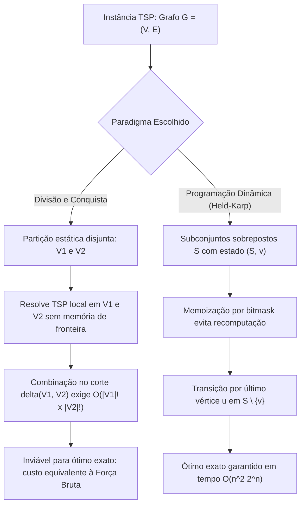

# 4. Estratégia 3: Justificativa Formal da Inviabilidade de Divisão e Conquista

**Responsável:** Integrante 3 — Maicon Brendo da Silva (Matrícula: `202204199`)  
**Status:** Concluído

---

## 4.1. Requisito do Edital e Contextualização

De acordo com o edital do trabalho prático, as estratégias de Força Bruta, Backtracking, Divisão e Conquista, Programação Dinâmica, Algoritmos Gulosos e Algoritmos Aproximados/Heurísticas devem ser analisadas para o Problema do Caixeiro Viajante (*Traveling Salesperson Problem* — TSP). Especificamente, o **Item 33** do edital prevê:

> *"Caso não seja tecnicamente viável resolver o problema utilizando qualquer uma das estratégias de projeto e análise de algoritmos mencionadas anteriormente, deverão ser apresentadas justificativas fundamentadas, acompanhadas de referências bibliográficas pertinentes."*

O TSP em sua formulação de otimização busca, dado um grafo completo ponderado $G = (V, E)$ com $|V| = n$ vértices e função de custo $w : E \to \mathbb{R}_{\ge 0}$, um ciclo hamiltoniano de custo mínimo. Sua versão de decisão pertence à classe **NP-Completo**, o que posiciona a versão de otimização na classe **NP-Difícil** `[1, 5]`. Enquanto paradigmas exatos como Força Bruta, Backtracking e Programação Dinâmica conseguem explorar ou estruturar o espaço de permutações mantendo garantia de otimalidade, o paradigma clássico de **Divisão e Conquista (D&C)** não é tecnicamente viável para obter a solução exata do TSP em grafos gerais, pelos motivos formais demonstrados a seguir.

---

## 4.2. Premissas Formais do Paradigma de Divisão e Conquista

Segundo Cormen et al. `[1, Cap. 2 e 4]` e Ziviani `[2]`, o paradigma de Divisão e Conquista resolve um problema de tamanho $n$ por meio de três etapas recursivas bem definidas:

1. **Dividir (*Divide*):** particionar a instância original em $a \ge 1$ subproblemas menores de tamanho aproximado $n / b$ (com $b > 1$), que preservam a mesma estrutura do problema original.
2. **Conquistar (*Conquer*):** resolver os subproblemas recursivamente; quando o tamanho do subproblema atinge um caso base suficientemente pequeno, resolvê-lo diretamente.
3. **Combinar (*Combine*):** fundir as soluções ótimas dos subproblemas para construir a solução ótima do problema original.

Conforme analisado por meio de recorrências clássicas e do Teorema Mestre `[1, Cap. 4]`, a eficiência do paradigma D&C — representada pela relação

$$T(n) = a \, T\!\left(\frac{n}{b}\right) + f(n)$$

depende criticamente de duas hipóteses estruturais:

- **Independência entre subproblemas:** os subproblemas gerados na etapa de divisão devem ser **disjuntos e independentes**, ou seja, a escolha ótima tomada dentro de um subproblema não pode invalidar ou depender das escolhas internas de outro subproblema.
- **Combinação em tempo eficiente:** o custo $f(n)$ da etapa de combinação deve ser polinomial e assintoticamente pequeno (tipicamente $O(n)$ ou $O(n \log n)$, como ocorre no *MergeSort* ou na busca do par de pontos mais próximos) `[1, 5]`.

Quando uma dessas premissas falha, o paradigma perde sua vantagem assintótica ou deixa de garantir a otimalidade global.

---

## 4.3. Demonstração da Inviabilidade para a Solução Ótima do TSP

### 4.3.1. Partição de Vértices e Corte de Fronteira

Considere uma tentativa natural de aplicar Divisão e Conquista ao TSP em um grafo completo $G = (V, E)$: particionar o conjunto de vértices $V$ em dois subconjuntos disjuntos e não vazios $V_1$ e $V_2$, tais que:

$$V = V_1 \cup V_2, \quad V_1 \cap V_2 = \emptyset, \quad |V_1| \approx \left\lfloor \frac{n}{2} \right\rfloor, \quad |V_2| \approx \left\lceil \frac{n}{2} \right\rceil$$

Essa partição define o **corte** $\delta(V_1, V_2)$ composto por todas as arestas que cruzam a fronteira entre os dois subconjuntos:

$$\delta(V_1, V_2) = \{ \{u, v\} \in E \mid u \in V_1,\; v \in V_2 \}$$

Na etapa de *Conquista*, o paradigma D&C resolveria o TSP isoladamente nos subgrafos induzidos $G[V_1]$ e $G[V_2]$, obtendo respectivamente os ciclos hamiltonianos ótimos locais $T_1^*$ (sobre $V_1$) e $T_2^*$ (sobre $V_2$).

### 4.3.2. Quebra da Independência e Falha da Subestrutura em Subconjuntos Isolados

A restrição fundamental do TSP é **global**: a solução deve formar um **único ciclo hamiltoniano** passando por todos os $n$ vértices exatamente uma vez. Isso provoca duas rupturas imediatas na premissa de independência:

1. **Múltiplos cruzamentos de fronteira:** qualquer ciclo hamiltoniano válido $T^*$ em $G$ deve cruzar o corte $\delta(V_1, V_2)$ um número par $2k$ de vezes ($k \ge 1$). Quando $k = 1$, o ciclo entra uma vez em $V_2$ e retorna uma vez para $V_1$, induzindo um caminho hamiltoniano em $V_1$ e outro em $V_2$. Contudo, no ótimo global $T^*$, é perfeitamente possível que $k \ge 2$ — isto é, o ciclo ótimo pode alternar várias vezes entre $V_1$ e $V_2$ para aproveitar arestas de fronteira muito baratas.
2. **Contraexemplo estrutural de otimalidade local:** considere um grafo com $6$ vértices dividido em $V_1 = \{0, 1, 2\}$ e $V_2 = \{3, 4, 5\}$, no qual as arestas internas de $V_1$ possuem custo $10$, exceto $(0, 1)$ de custo $1$, e as arestas internas de $V_2$ possuem custo $10$, exceto $(3, 4)$ de custo $1$. Se as arestas de corte $(1, 3)$, $(3, 2)$, $(2, 4)$, $(4, 5)$, $(5, 0)$ tiverem custo $1$, o ciclo global ótimo $0 \to 1 \to 3 \to 2 \to 4 \to 5 \to 0$ não contém os ciclos isolados $T_1^*$ nem $T_2^*$ e visita os vértices de $V_1$ e $V_2$ em ordem incompatível com qualquer junção simples de $T_1^*$ e $T_2^*$.

Portanto, os subproblemas definidos sobre $V_1$ e $V_2$ **não são independentes**: a melhor ordenação interna dos vértices de $V_1$ depende diretamente de quais vértices de $V_2$ atuam como pontos de entrada e saída no corte $\delta(V_1, V_2)$ `[2, 5]`.

### 4.3.3. Explosão Combinatória na Etapa de Combinação

Mesmo que se tentasse generalizar a etapa de *Conquista* para calcular não apenas ciclos fechados, mas **caminhos hamiltonianos abertos** entre pares de vértices de fronteira em $V_1$ e $V_2$, a etapa de *Combinar* continuaria inviável para garantir o ótimo exato:

- Se o ciclo ótimo cruzar a fronteira $2k$ vezes, é necessário escolher $k$ pares de vértices de entrada/saída em $V_1$ e $k$ pares compatíveis em $V_2$, além de garantir que a união dos segmentos não forme **subciclos desconexos** (*subtours*).
- Como $k$ pode variar de $1$ até $\min(|V_1|, |V_2|)$, o número de maneiras de parear vértices de fronteira e reordenar os caminhos internos cresce fatorialmente com o tamanho das partições, exigindo no pior caso a avaliação de $O(|V_1|! \times |V_2|!)$ combinações.
- Assim, o termo $f(n)$ da etapa de combinação torna-se assintoticamente equivalente à própria enumeração exaustiva da Força Bruta ($O(n!)$), anulando qualquer ganho do paradigma de Divisão e Conquista.

### 4.3.4. Solução Exata vs. Heurísticas de Partição Geométrica

É importante distinguir a impossibilidade de **resolução exata** da existência de **métodos aproximados** inspirados em Divisão e Conquista. Em 1977, Richard Karp `[7]` propôs um algoritmo de partição geométrica para o TSP Euclidiano no plano $\mathbb{R}^2$, no qual o plano é subdividido recursivamente em retângulos menores, cada subproblema é resolvido e os subciclos são costurados nas bordas.

Entretanto, o próprio Karp `[7]` demonstrou que essa abordagem é um **esquema de aproximação probabilístico** válido apenas sob hipóteses geométricas no plano euclidiano — ela **não garante a solução ótima exata** e não se aplica a grafos gerais (onde não há métrica planar nem desigualdade triangular garantida). Conforme destacam Kleinberg e Tardos `[5, Cap. 5 e 8]`, problemas com acoplamento global de permutação exigem armazenamento de subconjuntos sobrepostos (Programação Dinâmica) ou aceitação de subotimalidade (heurísticas e algoritmos aproximados).

---

## 4.4. Comparativo Estrutural: Divisão e Conquista vs. Programação Dinâmica

Enquanto a Divisão e Conquista falha por assumir partições disjuntas sem memória de fronteira, a **Programação Dinâmica** (algoritmo de Bellman-Held-Karp `[3]`) resolve o TSP de forma exata ao reconhecer a **sobreposição de subproblemas**: em vez de dividir $V$ ao meio de forma estática, expande-se progressivamente um subconjunto $S \subseteq V$ memorizando o custo ótimo $C(S, v)$ de terminar no vértice $v \in S$.

A tabela a seguir sintetiza a comparação estrutural entre os dois paradigmas no contexto do TSP:

| Critério Analisado | Divisão e Conquista (D&C) | Programação Dinâmica (Held-Karp) `[3]` |
| :--- | :--- | :--- |
| **Estrutura dos subproblemas** | Partições disjuntas $V_1 \cap V_2 = \emptyset$ | Subconjuntos sobrepostos $S \subseteq V$ com estado $(S, v)$ |
| **Independência entre subproblemas** | Inexistente (acoplamento no corte $\delta(V_1, V_2)$) | Capturada pelo último vértice visitado $v$ |
| **Custo da etapa de combinação** | Exponencial / fatorial: $O(\|V_1\|! \times \|V_2\|!)$ | Polinomial por estado: $O(n)$ transições por $(S, v)$ |
| **Garantia de otimalidade exata** | Não garantida (salvo enumeração completa) | **Garantida** (100% exata para grafos gerais) |
| **Complexidade resultante** | Degenera para $O(n!)$ (ou apenas heurística `[7]`) | $\Theta(n^2 2^n)$ em tempo e $\Theta(n 2^n)$ em espaço |

---

## 4.5. Referências Bibliográficas Pertinentes

- **[1]** CORMEN, T. H.; LEISERSON, C. E.; RIVEST, R. L.; STEIN, C. *Introduction to Algorithms*. 3. ed. Cambridge: The MIT Press / McGraw-Hill, 2009. (Cap. 2, Cap. 4: *Divide-and-Conquer*, Cap. 34 e Cap. 35).
- **[2]** ZIVIANI, N. *Projeto de Algoritmos com implementações em Java e C++*. 1. ed. São Paulo: Cengage Learning (Thomson/Pioneira), 2006.
- **[3]** HELD, M.; KARP, R. M. *A Dynamic Programming Approach to Sequencing Problems*. Journal of the Society for Industrial and Applied Mathematics (SIAM), v. 10, n. 1, p. 196–210, 1962.
- **[5]** KLEINBERG, J.; TARDOS, É. *Algorithm Design*. Boston: Pearson / Addison-Wesley, 2006. (Cap. 5: *Divide and Conquer*; Cap. 8: *NP and Computational Intractability*).
- **[7]** KARP, R. M. *Probabilistic Analysis of Partitioning Algorithms for the Traveling-Salesman Problem in the Plane*. Mathematics of Operations Research, v. 2, n. 3, p. 209–224, 1977.
