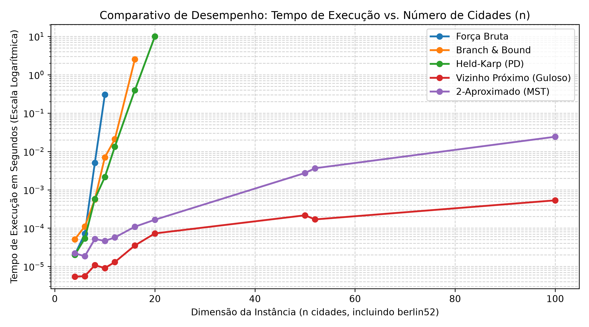
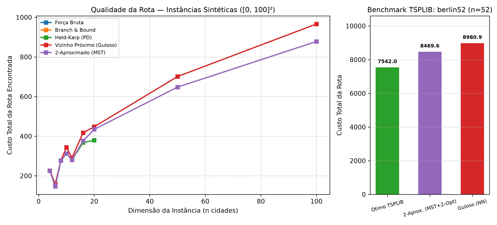

# 7. Análise de Resultados e Comparativo Global

**Responsáveis:** Todo o grupo (Consolidação com script unificado)  
**Status:** Concluído

---

## 7.1. Ambiente Metodológico e Tabela Comparativa Consolidada

Para assegurar equidade na comparação de tempo de execução, consumo de memória e qualidade das rotas entre os cinco algoritmos implementados, o benchmark comparativo global foi executado de forma unificada em um único ambiente de hardware e software através do script `scripts/run_comparison.py`:

- **Processador (CPU):** AMD Ryzen 7 7735HS (8 núcleos / 16 threads, clock base 3,20 GHz, boost até 4,75 GHz)
- **Sistema Operacional:** Windows 11 64-bit (`Windows-11-10.0.26300-SP0`, arquitetura `AMD64`)
- **Interpretador:** CPython 3.14.7 (64-bit)
- **Medição de Tempo:** `time.perf_counter()` isolando estritamente a execução algorítmica (sem leitura de disco).

> **Nota Metodológica:** Os tempos apresentados nos Capítulos 2, 3, 5 e 6 correspondem às validações unitárias conduzidas localmente na máquina de cada integrante responsável. A tabela consolidada a seguir apresenta a coleta unificada na máquina padrão para todas as **10 instâncias** do repositório ($n = 4$ até $n = 100$), ordenadas por dimensão.

Na tabela abaixo, cada célula de algoritmo exato informa **`Custo | Tempo (s) | Operações`**, e cada célula de algoritmo aproximado/guloso informa **`Custo | Tempo (s) | Operações | Erro (%)`** em relação ao custo ótimo conhecido $C^*$:

| Instância | $n$ | Ótimo ($C^*$) | Força Bruta (Custo \| $t$ \| Ops) | Backtracking B&B (Custo \| $t$ \| Ops) | Held-Karp PD (Custo \| $t$ \| Ops) | Guloso NN (Custo \| $t$ \| Ops \| Erro) | 2-Aproximado MST+2-Opt (Custo \| $t$ \| Ops \| Erro) |
| :--- | :---: | :---: | :--- | :--- | :--- | :--- | :--- |
| `tiny_4` | 4 | 226,30 | 226,30 \| 0,000020 s \| 6 | 226,30 \| 0,000052 s \| 8 | 226,30 \| 0,000029 s \| 12 | 226,30 \| 0,000007 s \| 6 \| 0,00% | 226,30 \| 0,000018 s \| 9 \| 0,00% |
| `small_6` | 6 | 147,14 | 147,14 \| 0,000073 s \| 120 | 147,14 \| 0,000114 s \| 36 | 147,14 \| 0,000053 s \| 80 | 159,36 \| 0,000005 s \| 15 \| +8,31% | 147,14 \| 0,000018 s \| 24 \| 0,00% |
| `small_8` | 8 | 277,32 | 277,32 \| 0,004760 s \| 5.040 | 277,32 \| 0,000436 s \| 49 | 277,32 \| 0,000350 s \| 448 | 277,32 \| 0,000007 s \| 28 \| 0,00% | 277,32 \| 0,000033 s \| 62 \| 0,00% |
| `medium_10` | 10 | 312,11 | 312,11 \| 0,314413 s \| 362.880 | 312,11 \| 0,007001 s \| 1.186 | 312,11 \| 0,002108 s \| 2.304 | 343,95 \| 0,000010 s \| 45 \| +10,20% | 312,11 \| 0,000045 s \| 102 \| 0,00% |
| `medium_12` | 12 | 280,79 | Estourou ($11! \approx 3{,}99 \times 10^7$) | 280,79 \| 0,017989 s \| 1.827 | 280,79 \| 0,012733 s \| 11.264 | 290,47 \| 0,000013 s \| 66 \| +3,45% | 280,79 \| 0,000057 s \| 148 \| 0,00% |
| `medium_16` | 16 | 368,30 | Estourou ($15! \approx 1{,}31 \times 10^{12}$) | 368,30 \| 2,579714 s \| 166.139 | 368,30 \| 0,433889 s \| 245.760 | 417,49 \| 0,000083 s \| 120 \| +13,36% | 376,60 \| 0,000165 s \| 361 \| +2,25% |
| `medium_20` | 20 | 379,34 | Estourou ($19! \approx 1{,}22 \times 10^{17}$) | Estourou (> limite prático $n=16$) | 379,34 \| 10,651596 s \| 4.980.736 | 447,74 \| 0,000038 s \| 190 \| +18,03% | 434,54 \| 0,000143 s \| 542 \| +14,55% |
| `large_50` | 50 | n/d | Estourou ($49!$) | Estourou (Tempo) | Estourou (RAM $\approx 13{,}8\text{ PB}$) | 701,24 \| 0,000129 s \| 1.225 \| n/d* | 647,77 \| 0,002602 s \| 13.242 \| n/d* |
| `berlin52` | 52 | 7.542,00** | Estourou ($51!$) | Estourou (Tempo) | Estourou (RAM $\approx 57{,}4\text{ PB}$) | 8.980,90 \| 0,000151 s \| 1.326 \| +19,08% | 8.469,63 \| 0,004203 s \| 18.807 \| +12,30% |
| `large_100` | 100 | n/d | Estourou ($99!$) | Estourou (Tempo) | Estourou (RAM $\approx 10^{31}\text{ estados}$) | 966,34 \| 0,000572 s \| 4.950 \| n/d* | 877,98 \| 0,024777 s \| 120.828 \| n/d* |

> **Legenda da Tabela:**
> - **Operações Contabilizadas (`Ops`):** Permutações avaliadas $(n-1)!$ na Força Bruta; nós expandidos na árvore de busca no Branch & Bound; estados únicos $(S, v)$ memoizados igual a $(n-1)2^{n-2}$ no Held-Karp; comparações de distância $n(n-1)/2$ no Guloso (Vizinho Mais Próximo); soma de relaxamentos do Prim e verificações de troca do 2-Opt no 2-Aproximado.
> - **`*` (`large_50` e `large_100`):** Instâncias euclidianas sintéticas geradas com sementes fixas para as quais o ótimo exato não é computável pelos métodos exatos implementados; em ambas, o 2-Aproximado (MST + 2-Opt) superou o Guloso, reduzindo o custo em **7,63%** (`647,77` vs. `701,24` em `large_50`) e em **9,14%** (`877,98` vs. `966,34` em `large_100`).
> - **`**` (`berlin52`):** Instância real clássica da biblioteca TSPLIB (52 localidades na cidade de Berlim), cujo custo ótimo global provado na literatura (com distâncias inteiras TSPLIB `EUC_2D`) é **$C^* = 7.542$** (e aproximadamente $7.544{,}37$ em distância euclidiana contínua sem arredondamento inteiro).

---

## 7.2. Gráficos de Desempenho e Discussão Comparativa

Os gráficos a seguir foram gerados automaticamente por `scripts/plot_results.py` a partir das execuções reais dos algoritmos sobre as instâncias do projeto:

### 7.2.1. Confronto entre os Algoritmos Exatos: Fatorial vs. Poda vs. Memoização

A análise conjunta da Tabela 7.1 e do gráfico de tempo de execução em escala logarítmica evidencia três regimes distintos de escalabilidade entre as abordagens que garantem a solução ótima ($C^*$):

1. **Explosão Fatorial da Força Bruta ($\Theta(n!)$):**
   - Por inspecionar exaustivamente todas as $(n-1)!$ permutações, a Força Bruta só é competitiva até $n = 6$ (`0,000073 s` para `120` rotas), onde a ausência de estruturas auxiliares lhe confere baixa constante multiplicativa.
   - Em $n = 8$ (`5.040` rotas), ela já é **10,9 vezes mais lenta** que o Branch & Bound e **13,6 vezes mais lenta** que o Held-Karp. Em $n = 10$ (`362.880` rotas), atinge `0,314413 s` — quase **150 vezes mais lenta** que a Programação Dinâmica (`0,002108 s`). A partir de $n = 12$ ($39.916.800$ rotas), torna-se inviável para execução interativa.

2. **Eficácia das Podas no Backtracking com Branch & Bound ($O(n^2 \cdot n!)$ no pior caso, espaço $O(n)$):**
   - A ordenação gulosa dos filhos combinada à cota inferior refinada reduz drasticamente o espaço de busca: em `medium_12`, o algoritmo expande apenas **1.827 nós** (e realiza `8.873` podas) frente às $39.916.800$ folhas da árvore completa, concluindo em `0,017989 s`.
   - Em `medium_16`, o Branch & Bound expande `166.139` nós de um total de $3{,}55 \times 10^{12}$ nós da árvore sem poda ($0{,}0000047\%$) e encontra o ótimo exato `368,30` em `2,579714 s`.
   - Apesar de manter consumo de memória linear $O(n)$, o tempo de CPU cresce rapidamente para $n \ge 20$ porque caminhos parciais distintos que visitam o mesmo subconjunto de cidades em ordens diferentes voltam a explorar subárvores equivalentes se a cota inferior não conseguir podá-los.

3. **Superioridade Assintótica temporal e Gargalo Espacial da Programação Dinâmica ($\Theta(n^2 2^n)$ em tempo, $\Theta(n 2^n)$ em espaço):**
   - O algoritmo de Bellman-Held-Karp elimina a redundância de permutações de mesmo prefixo ao colapsar $(k-1)!$ ordens internas de visita em um único estado memoizado $(S, v)$ codificado por *bitmask*.
   - Em `medium_16`, embora contabilize `245.760` estados (contra `166.139` nós do Branch & Bound), cada transição do Held-Karp é um laço simples sobre vetores contíguos pré-alocados, resultando em um tempo **5,9 vezes menor** (`0,433889 s` vs. `2,579714 s`).
   - Em `medium_20`, o Held-Karp é o único método exato a concluir dentro da janela padrão do benchmark (`10,651596 s` para `4.980.736` estados). Contudo, a duplicação da tabela a cada nova cidade impõe uma barreira física rígida de memória RAM a partir de $n \approx 25$, inviabilizando `large_50`, `berlin52` e `large_100` [1, 3, 6].

### 7.2.2. Confronto entre Métodos Exatos e Aproximados/Heurísticos

Para instâncias de médio e grande porte ($n \ge 50$), onde qualquer método exato de propósito geral esbarra na intratabilidade de problemas NP-Difíceis [1, 4], os métodos polinomiais demonstram o *trade-off* clássico entre **velocidade de resposta** e **qualidade da solução**:

1. **Velocidade sub-milissegundo do Guloso (Vizinho Mais Próximo — $\Theta(n^2)$):**
   - Executa exatamente $n(n-1)/2$ comparações determinísticas: apenas `1.225` operações em `large_50` (`0,000129 s`), `1.326` em `berlin52` (`0,000151 s`) e `4.950` em `large_100` (`0,000572 s`).
   - Entretanto, por tomar decisões míopes sem visão global do fechamento do ciclo, acumula arestas longas no final do percurso. Seu erro relativo foi de **+8,31%** em `small_6`, **+10,20%** em `medium_10`, **+13,36%** em `medium_16`, **+18,03%** em `medium_20` e **+19,08%** na instância real `berlin52`.

2. **Robustez e Qualidade do 2-Aproximado com MST + Refinamento 2-Opt:**
   - Em todas as 10 instâncias avaliadas, a combinação da Árvore Geradora Mínima (Prim + pré-ordem DFS) com busca local 2-Opt produziu rotas de custo **igual ou estritamente inferior** ao algoritmo Guloso.
   - Nas instâncias de $n = 4$ até $n = 12$, o MST + 2-Opt atingiu **0,00% de erro** (encontrando a própria solução ótima global em fração de milissegundo).
   - Em `medium_16`, apresentou erro de apenas **+2,25%** (`376,60` vs. ótimo `368,30`), sendo **2.629 vezes mais rápido** que o Held-Karp (`0,000165 s` vs. `0,433889 s`).
   - Em `medium_20`, obteve erro de **+14,55%** em `0,000143 s` (**74.486 vezes mais rápido** que os `10,65 s` do Held-Karp).
   - No benchmark real `berlin52` ($n = 52$), obteve custo `8.469,63` (**+12,30%** acima do ótimo `7.542` da TSPLIB, ou razão empírica $\alpha = 1{,}123$, muito abaixo do teto teórico $\alpha \le 2$ garantido pela desigualdade triangular [1]) em apenas **4,2 milissegundos**.
   - Em `large_100` ($n = 100$), concluiu a construção da MST e todas as varreduras de melhoria 2-Opt (`120.828` operações totais) em **24,78 milissegundos**, entregando uma rota `9,14%` mais econômica que a heurística gulosa.

### 7.2.3. Síntese de Recomendação Prática por Escala de Instância

| Faixa de Dimensão ($n$) | Estratégia Recomendada | Justificativa Técnica e Empírica |
| :--- | :--- | :--- |
| **$n \le 8$** | **Força Bruta** ou **Branch & Bound** | Código simples, espaço $O(n)$ e tempo inferior a $5\text{ ms}$ com garantia de ótimo exato. |
| **$9 \le n \le 16$** | **Held-Karp (PD)** ou **Branch & Bound** | Held-Karp oferece o menor tempo determinístico ($\le 0{,}43\text{ s}$); Branch & Bound é a alternativa caso a memória disponível seja restrita ($O(n)$). |
| **$17 \le n \le 22$** | **Programação Dinâmica (Held-Karp)** | Único método exato do projeto capaz de sustentar tempo viável (segundos a poucos minutos) antes do limite físico de memória RAM. |
| **$n > 22$ (ex.: $n = 50 \dots 100+$)** | **2-Aproximado (MST + 2-Opt)** | Garantia teórica formal ($\alpha \le 2$ em grafos métricos), desvio empírico baixo (0% a 14,5%) e execução em poucos milissegundos. |
